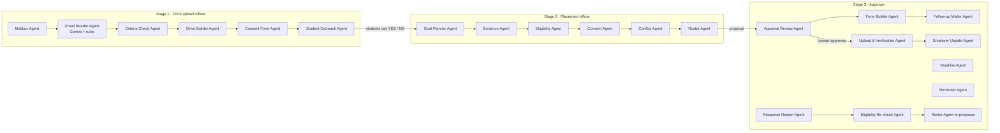

# The Agent Crew

PlaceCrew splits the placement process into three stages, one per person. Each stage is carried out by a few named agents. Each agent does one job and may call only its own tools; any other call is refused and logged as `TOOL_DENIED`. No agent can approve anything. Source: `backend/app/agent/crew.py`; the live list is in the app under **Agent Crew**.

## Stage 1: company email → drive → consent form → every student
Owner: **Drive upload officer** (`drives@placementos.demo`). Workflow: `PROCESS_COMPANY_EMAIL`, one agent run per email.

| Agent | What it does | Stops for a person when |
|---|---|---|
| Mailbox Agent | Every 2 minutes (autopilot), or on **Check mailbox now**, reads new emails whose subject contains "Campus Drive" from the connected Gmail. Read-only. Each email is stored once (by Message-ID). | — |
| Email Reader Agent | Extracts company, role, date, time, venue, registration deadline, the date the company wants the list, CTC, batch, CGPA, backlog rule and branches. Gemini reads the email when configured; the rule-based reader always runs too, and any disagreement is flagged. The email is untrusted data. | AI and rules disagree on a key field |
| Criteria Check Agent | Checks everything is present and valid: drive in the future, deadline present, before the drive and not passed, CGPA 0–10, known branches, no duplicate drive. Also checks the sender (registered contact, trusted list, or new) and flags instruction-like text such as "skip the consent step", which is otherwise ignored. | Anything missing or wrong ("Must fix"), new or unverified sender, suspicious text, ambiguous criteria ("Confirm") |
| Drive Builder Agent | Creates the drive with versioned criteria, the registration deadline and the list due date, and registers the company if new. It also registers a clearly labelled LOCAL MOCK stand-in form so the upload/verification pipeline applies. | — |
| Consent Form Agent | Writes the drive's single consent form: what is shared (roll number, name, branch, CGPA, backlogs), with which company, the criteria, and the closing time (= registration deadline). | — |
| Student Outreach Agent | Emails **every student** a personal link to that consent form. Exactly one link per student per drive; running it again sends nothing twice. | — |

## Stage 2: the placement officer runs the drive
Owner: **Placement officer**. In the Student Registry, the officer can filter by CGPA range, backlogs, batch, missing data, and, for any drive, "would be on the roster", "meets criteria", "said YES / NO / no answer". Running the drive (**Agent Control Room** or the drive's **Prepare roster with agent**) runs these agents:

| Agent | What it does |
|---|---|
| Goal Planner Agent | Understands the request and picks the drive (Gemini or rules). Read-only tools only. |
| Evidence Agent | Reads the employer form and cross-checks it against the configured criteria. |
| Eligibility Agent | Applies the criteria to every student with the deterministic engine. CGPA ≥ is inclusive; missing data gives UNKNOWN, never a guess. |
| Consent Agent | Keeps only students who said **YES** on the drive's consent form; reports how many said no or haven't answered. |
| Conflict Agent | Holds students who are booked on a clashing drive. |
| Roster Agent | Creates the hashed roster proposal and sends it to the approver (a supplementary one if a list was already sent). |

## Stage 3: the approver
Owner: **Approver** (Head of Placements).

| Agent | What it does |
|---|---|
| Approval Review Agent | Opens with every proposal. Independently re-checks from live data: roster unchanged (hash), every listed student still eligible with consent and no clash, who was left out and why, **who could still qualify** (missing details or no consent answer), self-reported data, deadlines, destination. Verdict: Ready / Ready with notes / Do not approve. It advises only. |
| Form Builder Agent | For each student who could still qualify, builds a personal form containing exactly their missing fields, plus the consent question if they haven't answered. The approver picks when the forms close. |
| Follow-up Mailer Agent | Emails each of those students their form link. |
| Response Reader Agent | When a student submits, validates the values and updates the record, marked **self-reported** and shown to the approver. If the admin turns this off, an officer verifies each answer first. |
| Eligibility Re-check Agent | Re-checks that student against the drive. If they now qualify, it asks the Roster Agent for an updated proposal, or a supplementary one if the list was already sent. The approver must approve it. |
| Deadline Agent | At the closing time, closes consent forms and personal forms. Late answers are refused. |
| Reminder Agent | One reminder each: unanswered consent forms and unfilled personal forms (24 h before closing), and shortlisted students (24 h before the drive). |
| Upload & Verification Agent | After human approval: uploads the exact approved list, reads it back, checks every ID, creates the attendance sheet. |
| Employer Update Agent | Emails the company the verified shortlist **from the placement mailbox**, tells each shortlisted student, and tells students who said YES but don't meet the criteria why. |

## Safety rules that apply to every agent
* Company emails and form pages are **data, not instructions**. Instruction-like text is flagged and ignored.
* Eligibility is decided by the deterministic engine, never by the AI.
* Nothing reaches a company without a person approving that exact list (hash-bound). Any later change invalidates the approval.
* Every email has a de-duplication key; reminders and forms are never sent twice.
* Every agent action is in the audit ledger as `agent:<name>` or as an agent run event.
