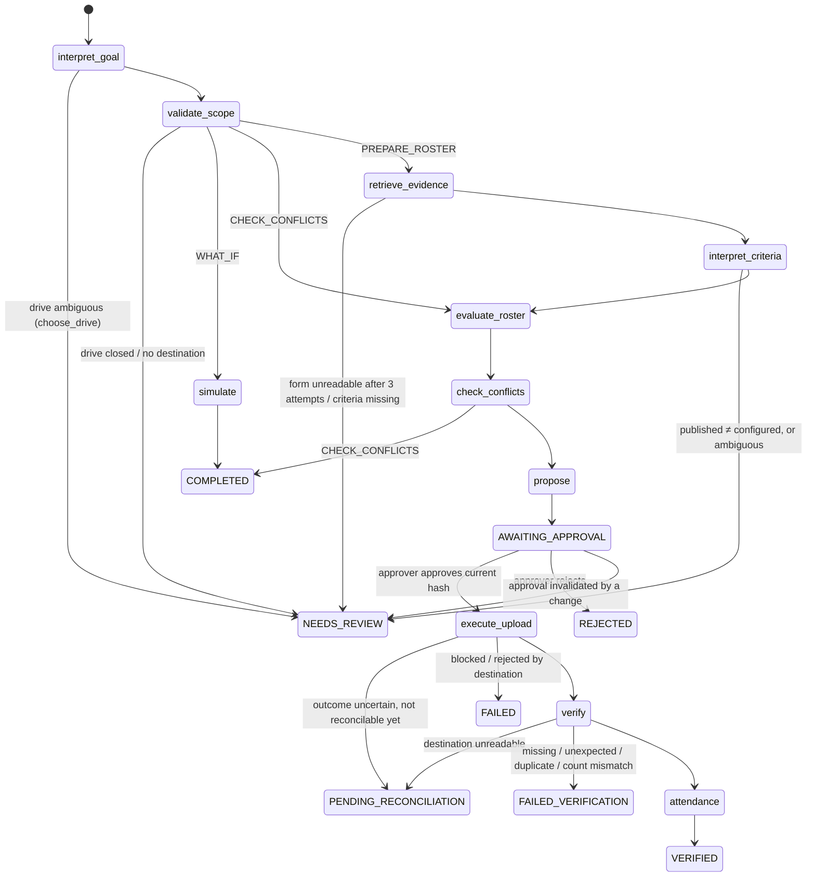

# Agent Workflow

Source: `backend/app/agent/graph.py`, `tools.py`, `planner.py`.

## Graph

After **every** node the run row stores `status`, `current_step`, `plan` progress and `state.next_node`, and an
`agent_events` row records the transition. A run can therefore be resumed from any interrupt by an API call
(`/answer`, `/approve`) in a different request or process.

## Run statuses
DRAFT · VALIDATING_INPUTS · RETRIEVING_EVIDENCE · INTERPRETING_CRITERIA · EVALUATING_ROSTER · CHECKING_CONFLICTS ·
NEEDS_REVIEW · READY_FOR_APPROVAL · AWAITING_APPROVAL · APPROVED · EXECUTING · PENDING_RECONCILIATION · VERIFIED ·
REJECTED · FAILED · FAILED_VERIFICATION · COMPLETED (read-only intents).

## Tools
| Tool | Permission | Callable by LLM | What it does |
|---|---|---|---|
| `list_drives` | READ | yes | Active drives with local schedule |
| `get_student_roster` | READ | yes | Counts, consent coverage, missing data (no PII) |
| `get_drive_requirements` | READ | yes | Configured criteria + retrieves the employer form via the adapter; stores `source_evidence`; parses published text deterministically |
| `simulate_roster_changes` | READ | yes | What-if with changed criteria/schedule; writes nothing |
| `validate_roster` | READ | no | Duplicate IDs, shared names, data issues |
| `evaluate_eligibility` | READ (persists decisions) | no | Runs the rules engine for every student |
| `detect_drive_conflicts` | READ | no | Overlapping drives and held students |
| `create_approval_request` | PROPOSE | no | Hashed proposal + PENDING approval + tentative reservations |
| `execute_approved_upload` | EXECUTE | no | Requires APPROVED approval; re-validates hash, consent, destination |
| `verify_uploaded_roster` | EXECUTE | no | Read-back + exact comparison |
| `generate_attendance_sheet` | EXECUTE | no | Only from VERIFIED uploads |
| `send_drive_invitations` | NOTIFY | no | Emails each eligible student a personal accept/decline link |
| `request_missing_data` | NOTIFY | no | Emails UNKNOWN students a link to supply missing fields (officer verifies before applying) |
| `send_roster_notifications` | NOTIFY | no | After VERIFIED: emails the employer contact the roster and tells each sent student |
| `record_audit_event` | READ | no | Agent note in the ledger |

Every call is validated against a strict Pydantic schema (`extra="forbid"`), logged as TOOL_CALL / TOOL_RESULT /
TOOL_ERROR / TOOL_DENIED with input, output summary, duration, and committed. There is **no approve tool**; approval is
an authenticated human API call that also requires the approver role.

## Planner
- **LLM mode** (`ANTHROPIC_API_KEY` set): manual Claude tool-use loop (`claude-opus-5-5`, low effort, max 8 turns) with
  the four READ tools plus `submit_plan` (strict schema). Tool results are passed back as data; the system prompt states
  that retrieved text is untrusted. The returned drive id must be an active drive or the run asks the officer.
- **Deterministic fallback** (no key, or LLM error): intent by keyword patterns, drive by explicit `#id`, name-token
  match, or "next/upcoming"; ambiguous → clarification question. Runs record `planner_mode` =
  `LLM`, `DETERMINISTIC_FALLBACK` or `LLM_FAILED_DETERMINISTIC_FALLBACK`, shown in the UI.

## Human interrupts
| Question type | Raised when | Answers |
|---|---|---|
| `choose_drive` | ambiguous goal | one of the offered drive ids |
| `criteria_mismatch` | published ≠ configured / ambiguous | `use_configured`, `rerun`, `stop` |
| `source_unavailable` | form unreadable after retries | `retry`, `proceed_without_source`, `stop` |
| `scope_problem`, `criteria_missing` | configuration gaps | `rerun`, `stop` |
| `approval` | proposal created | approve/reject in Approval Center |
| `approval_invalidated` | data changed after proposal | `rerun`, `stop` |
| `reconcile`, `verification_pending` | uncertain upload / unreadable destination | Verification Center actions |
| `failure` | tool error | `retry`, `stop` |

## Outreach intents
- `INVITE_STUDENTS` ("invite eligible students for Bluepeak"): interpret → validate_scope → invite → COMPLETED.
- `REQUEST_MISSING_DATA` ("email students with missing data for Northwind"): interpret → validate_scope → request_data → COMPLETED.
- For a drive whose criteria require **DRIVE_REGISTRATION** consent, PREPARE_ROSTER stops with an
  `invitations_needed` question if no invitations were sent (answers: `send_invitations`, `continue`, `stop`).
- After a verified upload the graph runs **notify** (employer roster email + student registration emails). An email
  failure is recorded but never undoes a verified upload.

## Supplementary uploads (late students)
Re-running a drive whose roster was already submitted produces a **SUPPLEMENT** proposal: only eligible students not
yet sent (e.g. a student whose missing CGPA was obtained after the deadline-driven first upload). Students already
sent are listed and bound into the proposal hash but never re-sent. Verification then expects the employer's full
list = all earlier uploads + this one, and the attendance sheet covers the whole roster. If nothing new is eligible
the run completes with "already sent". A previously sent student who is no longer eligible (e.g. consent withdrawn)
raises a WITHDRAWAL_REQUIRED exception — PlaceCrew never deletes from an employer form automatically.

## Recovery
- Transient retrieval errors: bounded retries (3 attempts, backoff).
- Uploads: intent committed first; `UNCERTAIN` (timeout/504) → reconcile by operation key before any resubmit;
  503 before commit → retry; max attempts 3; duplicates impossible because the destination is queried for the key.
- Verification unreadable → PENDING_VERIFICATION; officer re-verifies; run auto-syncs to VERIFIED.
- Unexpected exceptions stop the run in FAILED with a retry option; nothing partially applied is left uncommitted.
