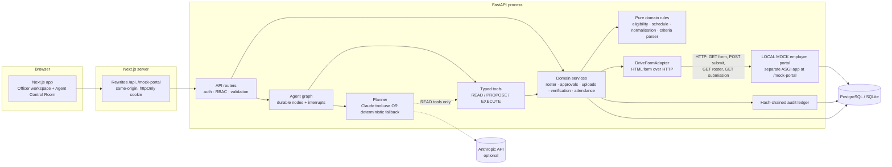

# Architecture

## Layers
| Layer | Location | Responsibility | Depends on |
|---|---|---|---|
| Domain rules | `backend/app/domain/` | Eligibility, interval overlap, branch/CGPA parsing, criteria-text extraction. Pure functions, no I/O, no LLM. | — |
| Services | `backend/app/services/` | Roster evaluation, proposals/approvals, uploads, verification, attendance, imports, drives, exceptions, Test Lab | domain, models, adapter registry, ledger |
| Agent | `backend/app/agent/` | `graph.py` nodes and runtime, `tools.py` typed tools + permission checks, `planner.py` LLM/fallback, `events.py` persisted log | services |
| Integrations | `backend/app/integrations/` | `DriveFormAdapter` protocol, HTML/HTTP implementation, allowlist enforcement | — |
| Mock portal | `backend/app/mock_portal/` | Simulated employer destination with its own tables; only reachable over HTTP | — |
| API | `backend/app/api/` | Routers, RBAC dependencies, explicit serializers | services, agent |
| Frontend | `frontend/` | Pages per workflow, typed API client, design system components | API over same origin |

## Key design decisions
- **One coordinator agent, many tools.** Multiple agents would add no demonstrable benefit; the graph makes control flow
  explicit and inspectable.
- **Custom durable graph instead of LangGraph.** Runs must pause for a human for hours and resume from a different HTTP
  request (possibly another serverless instance). Persisting `next_node` + state in the `agent_runs` row after every
  node gives that with no extra infrastructure, and every transition is visible in the event log.
- **LLM limited to interpretation.** The planner can call READ tools and must end with a validated `submit_plan`.
  It cannot propose, execute or approve; drive ids it returns are re-checked by the backend.
- **Everything recomputes.** Approval, pre-execution and re-validation all call the same `evaluate_drive()` and compare
  hashes, so there is no cached decision that can drift.
- **Mock destination behind the real adapter.** The LOCAL MOCK portal renders HTML pages; the adapter parses them the
  way a browser-automation adapter would. Swapping in the organiser's form = new allowlisted destination (+ a Playwright
  adapter if the form needs JavaScript), no domain changes.
- **Same-origin frontend.** Next.js rewrites `/api` to the backend: the session cookie is first-party and httpOnly, and
  no backend URL or secret is in the client bundle.

## Request flows
**Agent run (`POST /api/agent/runs`)** executes nodes inline until an interrupt and commits after each node; the UI
polls `/events` and renders only persisted rows.
**Approval (`POST /api/approvals/{id}/approve`)** → role check → reviewed-hash check → live recomputation → APPROVED →
`resume_after_approval` runs upload → verify → attendance in the same request.

## Concurrency and consistency
- Upload intent is committed before the external call; outcome UNCERTAIN triggers reconciliation by operation key.
- Audit appends take a PostgreSQL advisory transaction lock to keep the chain linear.
- Test Lab runs use a separate in-memory database and a separate mock portal; adapter overrides are `ContextVar`s, so
  they cannot redirect a concurrent real request.
