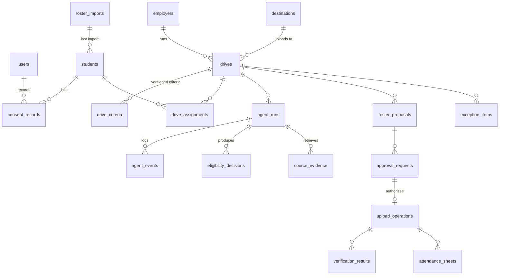

# Data Model

Source: `backend/app/models/entities.py`, migrations `backend/migrations/versions/0001`–`0005`.
PostgreSQL schema verified identical to the models with `alembic check`.

| Table | Purpose | Integrity |
|---|---|---|
| `users` | Accounts and role (admin/officer/approver/viewer) | unique email; PBKDF2 password hash |
| `students` | Roster; **roll_number is the business key**, name is never used to match; `self_reported` lists values a student supplied through a personal form | unique roll_number; CHECK cgpa 0–10, backlogs ≥ 0; `record_version` increments on change |
| `consent_records` | Append-only consent history per scope; latest wins | FK student; index (student, scope, id) |
| `roster_imports` | File hash, mapping, normalised preview rows, per-row issues, outcome counts | commit applies exactly the previewed rows |
| `employers`, `destinations` | Employer and allowlisted upload targets | unique employer name; destination `config_version` |
| `drives` | Title, UTC start/end, IANA timezone, status, destination, `schedule_version`, `registration_deadline` (consent form closes), `roster_due_at` (company wants the list) | CHECK ends_at > starts_at |
| `drive_criteria` | Immutable criteria versions (min CGPA inclusive, backlog policy, branches, batches, consent scope, source text) | unique (drive, version) |
| `drive_assignments` | PROPOSED / CONFIRMED / HELD_CONFLICT / WITHDRAWN per student per drive | unique (student, drive) |
| `agent_runs` | Objective, planner mode, intent, status, plan, durable state incl. `next_node`, pending question | |
| `agent_events` | Every node transition and tool call with input/output and duration | unique (run, seq) |
| `eligibility_decisions` | Per-student decision with rule results, reasons, missing evidence, consent, conflicts, **criteria version and student record version** | older rows marked `is_stale` |
| `roster_proposals` | `kind` FULL/SUPPLEMENT, roll numbers to upload, previously submitted roll numbers, excluded/held with reasons, criteria & schedule versions, destination fingerprint, **proposal_hash** | |
| `approval_requests` | Status, bound hash, requester (agent run + user), decider, note, invalidation reason | |
| `upload_operations` | **operation_key** (unique), attempts, attempt log, destination receipt | unique operation_key |
| `verification_results` | Expected/observed counts, missing/unexpected/duplicate IDs, read-back snapshot, receipt hash | |
| `attendance_sheets` | Generated CSV, roll numbers, consent exclusions at generation, SHA-256, purge timestamp | |
| `source_evidence` | Retrieved employer form definition and parse result with content hash | |
| `exception_items` | Inbox items with dedupe key, severity, resolution and resolver | unique dedupe_key |
| `audit_events` | Append-only ledger: seq, actor, action, entity, operation id, run, drive, redacted details, prev_hash, hash | unique seq; PG trigger blocks UPDATE/DELETE |
| `student_requests` | Personal tokenised links: DRIVE_INVITATION (accept/decline → per-drive consent `DRIVE:<id>`) or DATA_REQUEST (student-submitted values await officer review); status, expiry, response | unique token (256-bit) |
| `email_messages` | Outbox: category, recipient, subject, body, status (DELIVERED_LOCAL / SENT / FAILED / SKIPPED), transport, links to student/drive/upload/request | unique dedupe_key (no duplicate sends) |
| `drive_results` | Employer outcome per sent student: SELECTED / NOT_SELECTED / ABSENT / WITHDRAWN | unique (drive, student) |
| `inbound_emails` | Company recruitment emails (Gmail / IMAP / pasted / demo): sender, subject, body (untrusted), extraction (AI or rules, with source lines), officer corrections, issues, status, resulting drive and agent run | unique message_id (each email stored once) |
| `consent_forms` | One consent form per drive: description, questions, audience (all students / eligible), closing time, status | unique drive_id |
| `oauth_credentials` | The connected Google account for the placement mailbox; refresh token encrypted (key derived from JWT_SECRET) | unique provider |
| `test_runs` | Test Lab results: fixture, expected, actual, checks, evidence | |
| `app_settings` | Configurable institutional policy | |
| `mock_portal_*` | Owned by the LOCAL MOCK portal only; core code never touches them | |

## Traceability chain
`upload_operation.operation_key` → `approval_request` (approver, time, bound hash) → `roster_proposal`
(criteria version, schedule version, destination fingerprint, included IDs + record versions) →
`eligibility_decisions` (per-rule results for that criteria version) → `drive_criteria` row (with employer source
text) and `students`/`consent_records` → `roster_import` (file SHA-256). Every step is also an `audit_events` entry.

## Proposal hash
`sha256(canonical_json({drive_id, criteria_version, schedule_version, destination_fingerprint,
included: [[roll_number, record_version], ...]}))`. Any change to criteria, schedule, destination configuration, a
student's record, consent, or clash state that changes the included set or versions produces a different hash.
